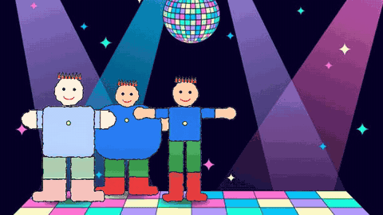
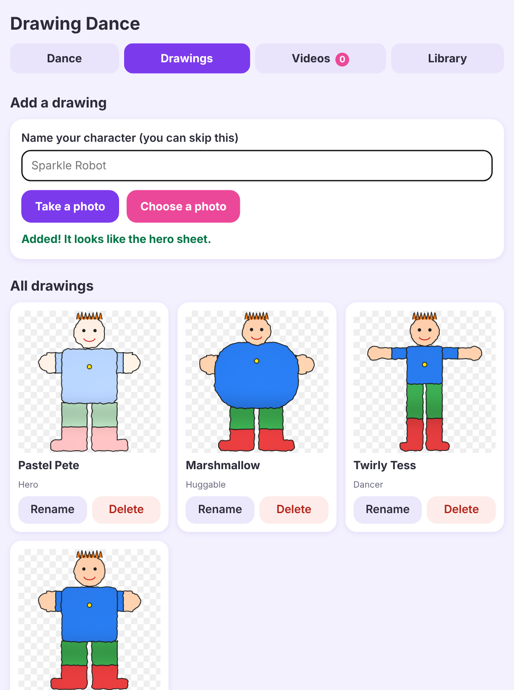
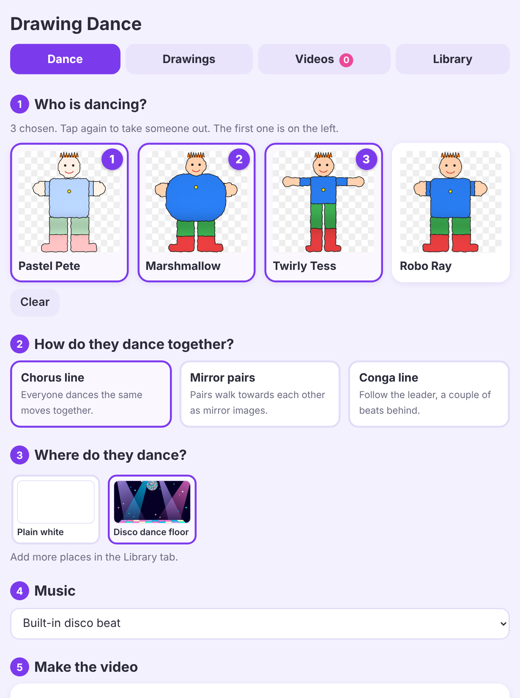
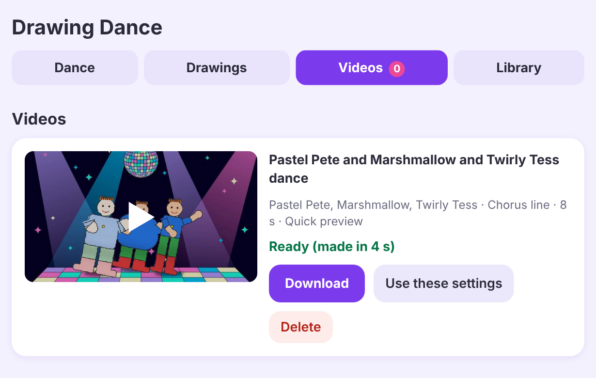

# Drawing Dance

Turn a child's drawing into a dancing video. Kids colour in a printed person-shaped template, you photograph the
sheet, and the app cuts the drawing out, splits it into body parts and makes it dance to a beat, in front of any
background you like. Several drawings can dance together.

It runs as a small web app on your home network, so kids can use it from a tablet: take a photo of the sheet, see the
cut-out appear in a shared gallery, pick who dances, and watch the video. It also has a command line for scripting.

## Features

- Straightens the photo using four corner markers, evens out the lighting and removes the paper and outline.
  Anything the child didn't colour is transparent, so thin arms and legs stay thin.
- Three printable templates for different characters (a sturdy all-rounder, a round huggable one and a slim dancer).
  The right one is detected automatically from the corner markers.
- A beat-locked routine: waves, arm swings, disco point, raise the roof, clap, shimmy and twirl, with a foot landing on
  every beat. The dancer walks back and forth across the floor and spins at each end.
- Several drawings dance in unison, as mirror-image pairs or in a conga line.
- Dancers stand on the floor by the bottom of their own drawing, so short characters don't float.
- Music: a built-in synthesized disco beat, or upload your own track and set its tempo.
- Works with iPhone and iPad photos (HEIC) as well as JPEG and PNG.
- Videos are made one at a time in a queue with a progress bar. A 16 second video takes about 20 seconds on a small
  home server (4 threads) and less on a modern laptop.

## Quick start with Docker

You need Docker with Compose. From this folder:

    mkdir -p data && sudo chown -R 1000:1000 data     # the app runs as user id 1000
    docker compose up -d --build

Then open `http://<your machine>:8080` in a browser or on a tablet on the same network. Everything you add (drawings,
backgrounds, music, videos) is saved in `./data`, so backing up that folder backs up the lot. To use another port:
`DRAWINGS_HOST_PORT=8090 docker compose up -d`.

**There are no logins.** Only run it on a network you trust, and don't expose it to the internet without putting a
password in front of it.

## Quick start without Docker

You need Python 3.10 or newer and ffmpeg.

    pip install -r requirements-web.txt
    python3 -m webapp                       # then open http://localhost:8080

Settings are environment variables: `DRAWINGS_DATA` (where things are saved, default `./data`), `DRAWINGS_PORT` (8080),
`DRAWINGS_MAX_UPLOAD_MB` (25), `DRAWINGS_MAX_MUSIC_MB` (60) and `DRAWINGS_RENDER_WORKERS` (parallel frame workers,
default automatic).

## Making a drawing

1. Print a template from `templates/` on A4 at 100% scale (turn off "fit to page"):
   `template_hero.pdf` (sturdy all-rounder), `template_huggable.pdf` (big round body, small head) or
   `template_dancer.pdf` (slim, long arms and legs). `template_original.pdf` is the first, narrow version and still works.
2. Colour inside the grey outline. Going a little outside it (hair, a hat, a cape) is fine.
3. Photograph the sheet flat in even light with all four black corner squares in the shot.
4. Add it in the web app (**Drawings** tab), or run `python3 animate.py photo.jpg --out out/dance.mp4`.

`python3 -m animator.template` regenerates the printable sheets, and `python3 tools/simulate_drawing.py` makes fake
drawings and photos for testing.

## More documentation

- [Command line guide](docs/CLI.md): every option, the dance moves, group styles and music.

## How it works

1. `animator/extract.py` finds the corner markers, straightens the photo, flattens the lighting and cuts out the ink.
2. The drawing is split into ten body parts using fixed joint positions printed on the template, so no joint detection is
   needed.
3. `animator/rig.py` is a small 2D puppet rig. `animator/choreo.py` is the dance routine, a list of moves on a beat grid.
4. `animator/engine.py` renders frames in parallel and pipes them to ffmpeg.
5. `webapp/` is a small Starlette app: a JSON API, SQLite plus files for storage, a one-at-a-time render queue and a
   plain JavaScript front end with no build step.

## Project layout

    webapp/                    the web app: API, storage, render queue, pages in static/
    animator/                  the engine: template geometry, extraction, puppet rig, choreography, music, rendering
    animate.py                 the command line
    templates/                 printable sheets
    samples/                   synthetic test photos and a dance floor background
    tests/                     automated tests (python3 -m unittest discover -s tests)
    tools/                     helpers: fake drawing generator, benchmark, Docker smoke test

## Tests

    python3 -m unittest discover -s tests -v

Takes about a minute and a half. Two tests that need a real iPhone HEIC photo are skipped unless you add one at
`samples/IMG_0154.HEIC`.

## Known limits

- The spin is a flat paper-puppet flip, not a true 3D turn.
- Your own music is not beat-detected, so it needs a steady tempo that you enter yourself.
- The figure is always arms-out: arms and legs bend at the shoulder, elbow, hip and knee, and nothing else.
- One background image per video, and only the dancers move.

## Licence

MIT, see [LICENSE](LICENSE). The corner-marker detection uses OpenCV's ArUco support.
This is an independent hobby project. It is inspired by the idea of seeing a child's drawing come to life, and is not
affiliated with or endorsed by any company or brand.
